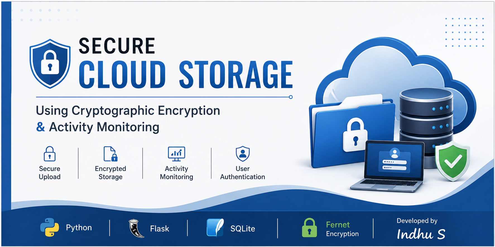
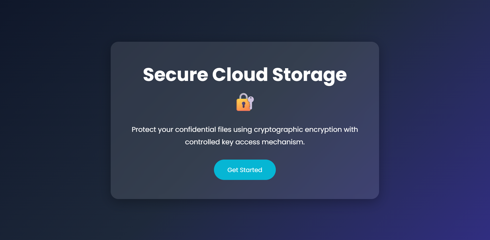
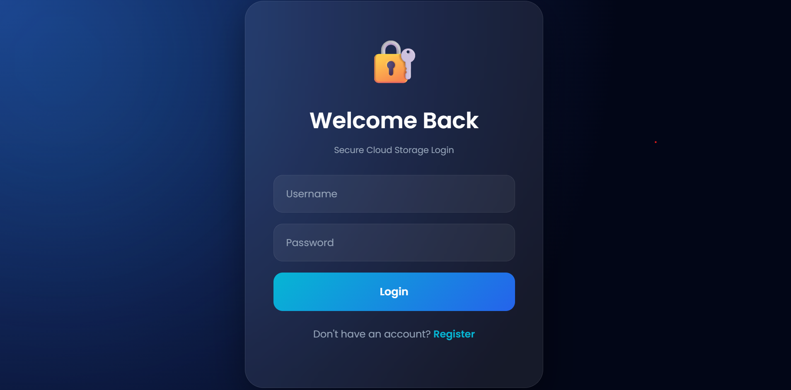
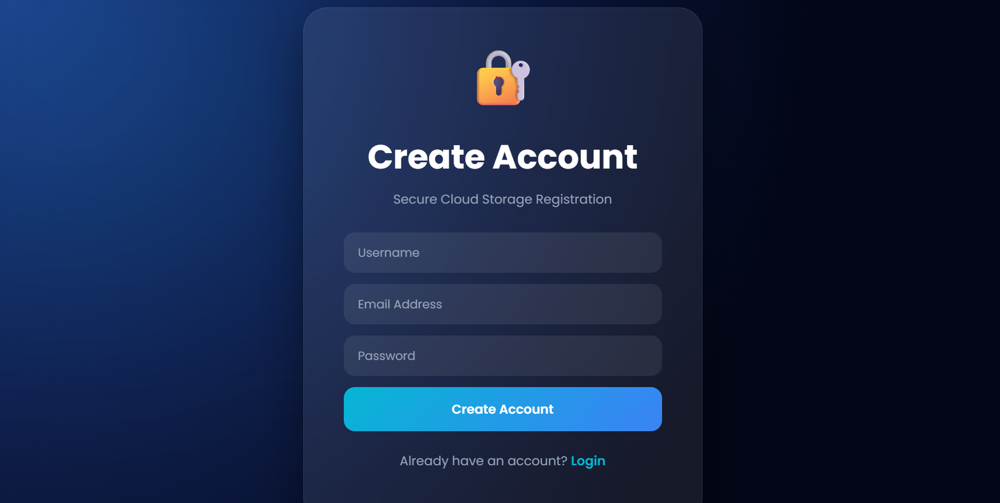
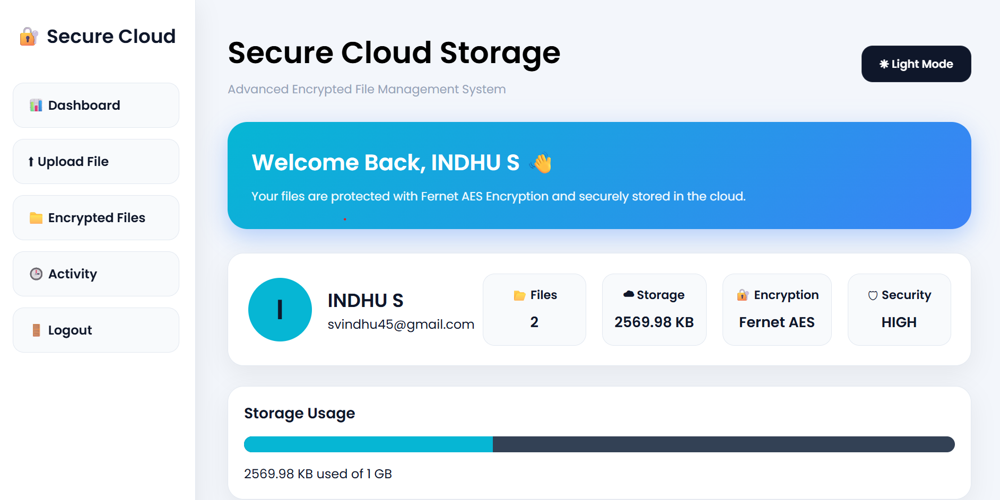
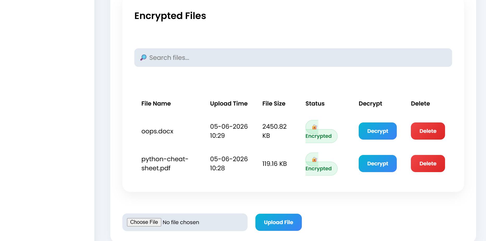
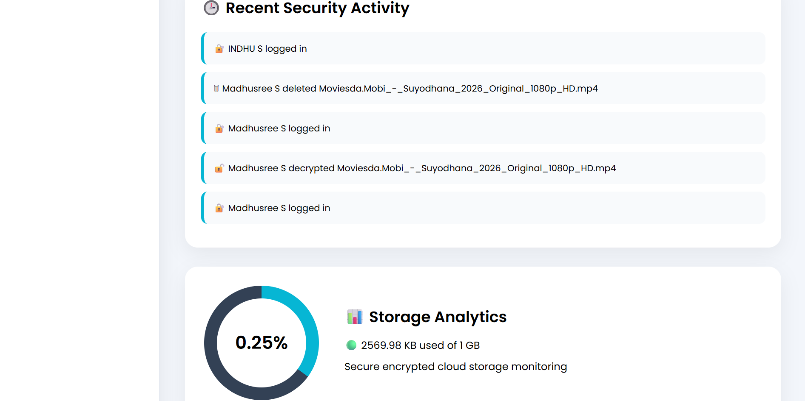

<p align="center">
  
</p>
<h1 align="center">🔐 Secure Cloud Storage Using Cryptographic Encryption and Activity Monitoring</h1>

<p align="center">
A secure cloud storage web application built using Python Flask that protects user files through cryptographic encryption, secure authentication, and activity monitoring.
</p>

<p align="center">


</p>

---
# 🔐 Secure Cloud Storage Using Cryptographic Encryption and Activity Monitoring

A secure cloud storage web application developed using **Python Flask** that protects user files with **Fernet Cryptographic Encryption**, provides **controlled user access**, and records **user activities** to ensure data security and accountability.

---

## 📖 Project Overview

This project provides a secure platform where users can register, log in, upload files, encrypt them before storage, decrypt authorized files, and monitor all important activities. The system is designed to improve the confidentiality, integrity, and management of stored data.

---

## ✨ Features

- User Registration & Login
- Secure File Upload
- Fernet Cryptographic Encryption
- Secure File Decryption
- Activity Monitoring
- Storage Analytics Dashboard
- User Authentication
- Responsive User Interface

---

## 🛠️ Technology Stack

| Category | Technology |
|----------|------------|
| Programming Language | Python |
| Framework | Flask |
| Frontend | HTML5, CSS3, JavaScript |
| Database | SQLite |
| Encryption | Fernet (Cryptography Library) |
| IDE | Visual Studio Code |

---

# 📸 Project Screenshots

## 🏠 Home Page



---

## 🔐 Login Page



---

## 📝 Register Page



---

## 📊 Dashboard



---

## 📂 Encrypted Files



---

## 📈 Storage Analytics & Activity Monitoring




---

## 📂 Project Structure

```text
secure-cloud-storage-cryptographic-encryption
│
├── app.py
├── static/
├── templates/
├── screenshots/
├── requirements.txt
├── LICENSE
└── README.md
```

---

## 🚀 Installation

```bash
git clone https://github.com/Indhu-Sivasamy/secure-cloud-storage-cryptographic-encryption.git
```

```bash
cd secure-cloud-storage-cryptographic-encryption
```

```bash
pip install -r requirements.txt
```

```bash
python app.py
```

---

## 🔒 Security Features

- Fernet Cryptographic Encryption
- Secure User Authentication
- Controlled File Access
- Activity Monitoring
- Secure File Management

---

## 🚀 Future Enhancements

- Multi-Factor Authentication (MFA)
- Cloud Integration (AWS / Azure)
- Secure File Sharing
- Email Notifications
- Mobile Application Support

---

## 👩‍💻 Developed By

**Indhu S**

Master of Computer Applications (MCA)

Rathinam Technical Campus

---

⭐ If you found this project useful, consider giving it a **Star** on GitHub.
